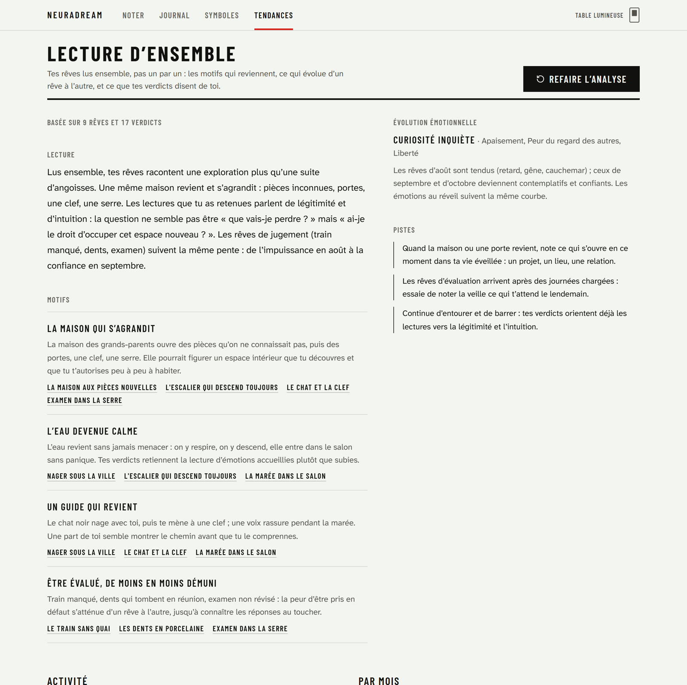
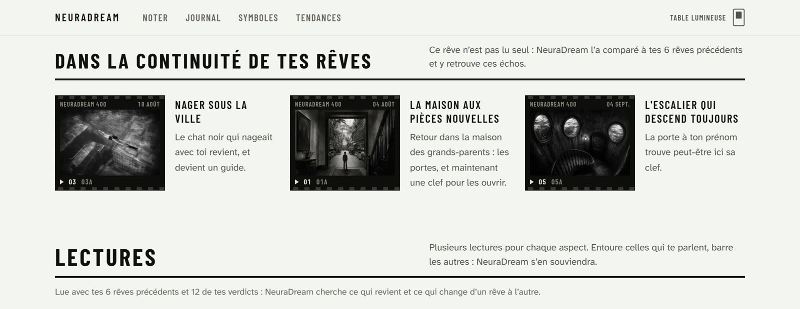
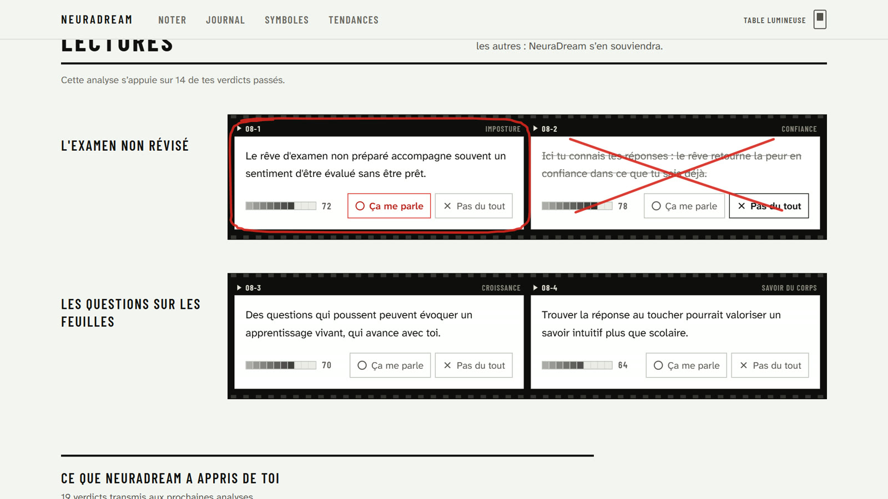
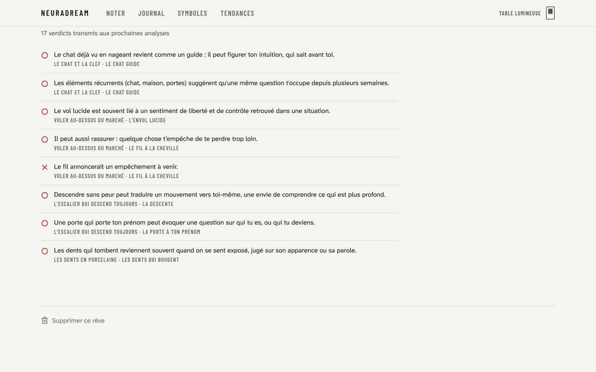
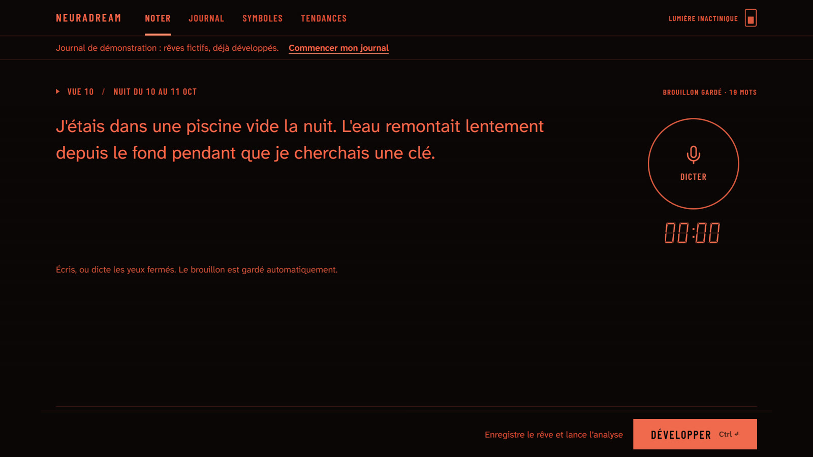
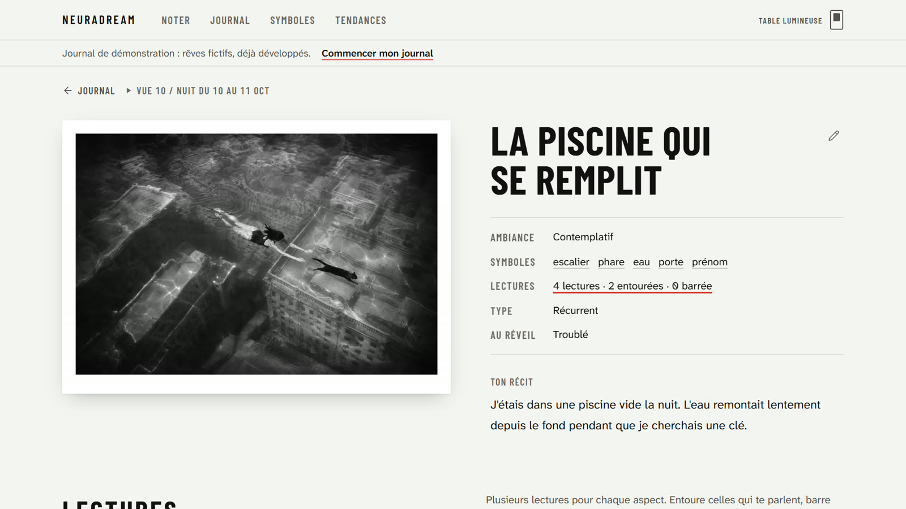
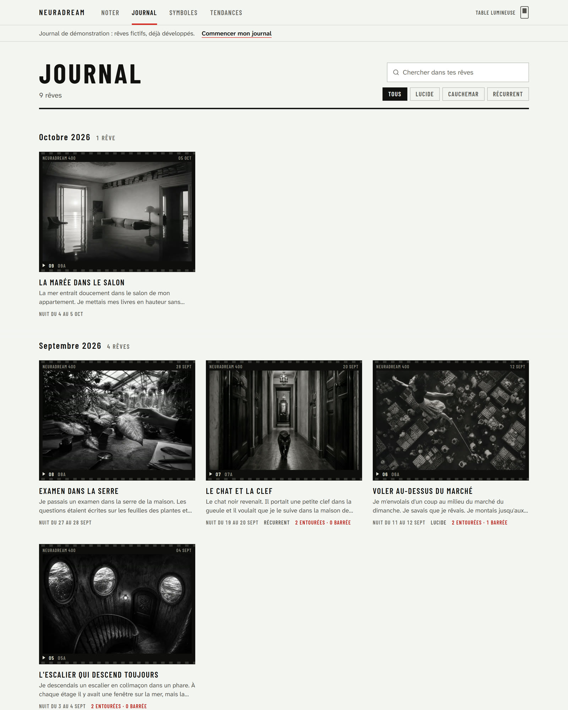
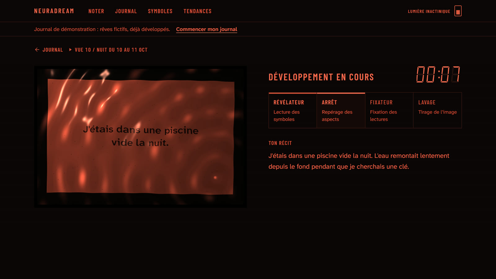
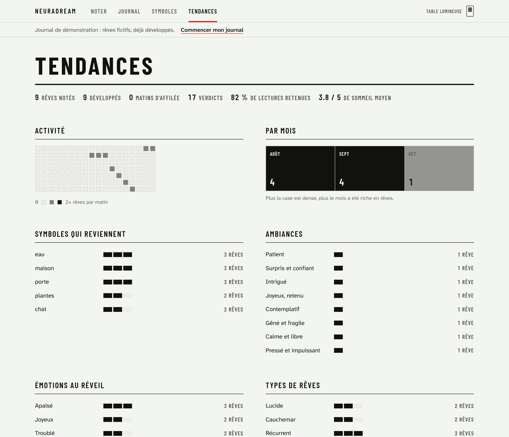
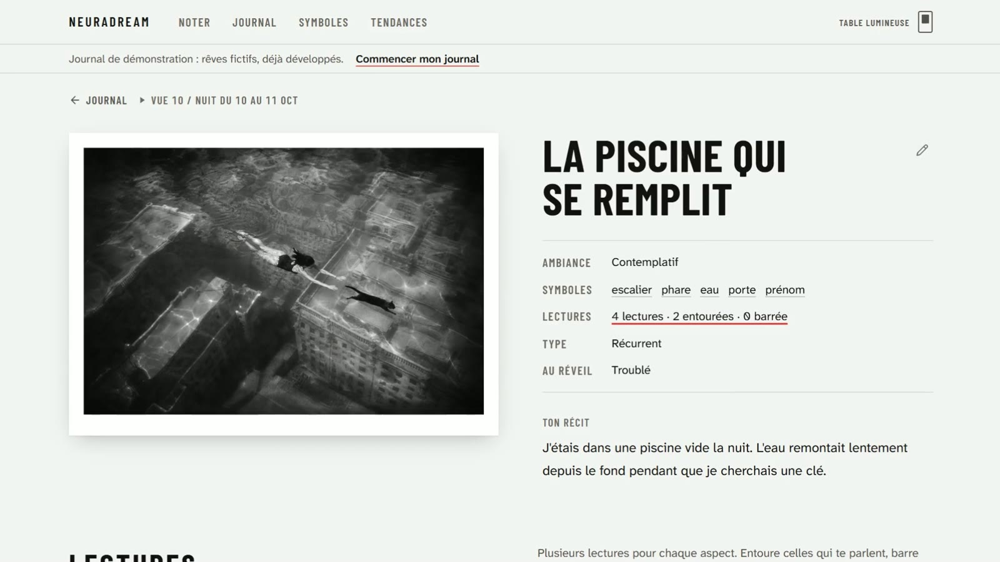

# 🌙 NeuraDream · Case Study

> Un journal de rêves qui ne lit pas les rêves un par un mais **comme une série** : il repère les **motifs qui reviennent** d'une nuit à l'autre, relie chaque nouveau rêve aux précédents, et **apprend des lectures que tu retiens** pour donner des réponses de plus en plus personnelles.

<div align="center">
  
  <br/>
  <em>Le moment signature : le rêve se développe dans la cuve, puis la lumière s'allume sur le tirage.</em>
</div>

---

## 🔗 Liens

- **Application :** [neuradream.netlify.app](https://neuradream.netlify.app/) (journal de démonstration pré-rempli, analyse IA réelle limitée par jour)
- **Film de présentation (32 s) :** [public/v2/neuradream-film.mp4](./public/v2/neuradream-film.mp4)
- **Documentation technique :** [docs/TECHNICAL.md](./docs/TECHNICAL.md)

---

## 👋 Contexte

NeuraDream est né comme un prototype : on raconte son rêve, une IA l'interprète. La première version fonctionnait, mais elle ressemblait à toutes les apps de rêves générées par IA : ciel étoilé bleu nuit, cartes translucides, boutons violets, une interprétation par rêve. Et le case study promettait une « IA qui apprend de vous » que le code ne faisait pas encore.

En octobre 2026, j'ai repris le produit de zéro avec deux objectifs :

1. **Rendre vrai ce que le case study promettait** : chaque rêve est lu à la lumière des précédents, et les lectures validées nourrissent réellement les analyses suivantes.
2. **Donner au produit une identité qu'on n'oublie pas**, au service de deux moments très différents : noter un rêve à moitié réveillé, puis le relire au calme.

---

## 🎯 La différence NeuraDream : lire les rêves ensemble

Les apps comme [DreamApp](https://dreamapp.io/) ou [Dream Journal Ultimate](https://dreamjournal.co/) interprètent **chaque rêve isolément**, comme si la nuit précédente n'existait pas. Or un rêve prend souvent son sens dans une série : une maison qui revient en s'agrandissant, une eau d'abord menaçante puis calme, une peur d'être jugé qui s'atténue d'un mois à l'autre.

NeuraDream lit le journal **comme un tout**, à trois niveaux :

| Niveau | Ce que fait NeuraDream | Ce que ça change |
|---|---|---|
| **Chaque nouveau rêve** | L'analyse reçoit tes rêves récents (titres, symboles, ambiances) et tes verdicts. Elle relie le rêve à ceux qu'il prolonge et explique pourquoi. | « Dans la continuité de tes rêves » : le chat qui nageait avec toi revient et devient un guide. |
| **La lecture d'ensemble** | Une analyse transversale des rêves récents : motifs récurrents, évolution émotionnelle, pistes de réflexion. | Des patterns qu'aucune interprétation isolée ne verrait, avec les rêves concernés. |
| **La boucle d'apprentissage** | Les lectures que tu entoures ou barres partent avec les analyses suivantes. | Des réponses de plus en plus personnelles, dans les angles qui te parlent. |

<div align="center">
  
  <br/>
  <em>La lecture d'ensemble : les motifs qui reviennent (la maison qui s'agrandit, l'eau devenue calme, un guide qui revient…), les rêves qui les portent et l'évolution émotionnelle.</em>
</div>

<div align="center">
  
  <br/>
  <em>Chaque rêve est lu avec les précédents : NeuraDream montre ceux qu'il prolonge et ce qui a changé.</em>
</div>

### Plusieurs lectures, et c'est toi qui tranches

À l'échelle d'un rêve, NeuraDream découpe le récit en aspects (« la chute », « la porte à ton prénom »…) et propose pour chacun **2 à 3 lectures sous des angles différents** (continuité avec la veille, régulation émotionnelle, symbolique jungienne…), chacune avec un indice de confiance. On entoure celles qui parlent, on barre les autres : ces verdicts deviennent le contexte personnel des analyses suivantes et de la lecture d'ensemble.

```
Rêve noté (texte ou dictée)
    ↓
Analyse du rêve + tes 12 derniers rêves + tes 24 derniers verdicts
    ↓
Titre, ambiance, symboles, aspects × lectures, rêves qu'il prolonge
    ↓
Tu entoures ou barres chaque lecture
    ↓
Lecture d'ensemble : motifs récurrents et évolution, guidés par tes verdicts
    ↓
Chaque nouveau rêve est lu avec tout ce qui précède
```

<div align="center">
  
  <br/>
  <em>Chaque lecture est une vue sur une planche-contact. On entoure au crayon gras, on barre ce qui ne parle pas.</em>
</div>

<div align="center">
  
  <br/>
  <em>La boucle d'apprentissage est visible : chaque verdict apparaît dans « Ce que NeuraDream a appris de toi », et chaque analyse indique sur combien de verdicts elle s'appuie.</em>
</div>

---

## 🎞️ Le design : « Chambre noire »

### Refuser le look par défaut

J'ai traité l'ancienne interface comme un contre-exemple. Plutôt que d'améliorer une nuit étoilée violette, j'ai exploré plusieurs mondes visuels issus de l'univers du rêve et de la nuit (almanach de clefs des songes, pochettes de disques, labo photo…) et choisi celui qui portait le mieux le produit : **la chambre noire d'un photographe**.

Un rêve se développe comme un tirage. Il apparaît lentement, sous une lumière qui ne réveille pas, puis on l'examine à la lumière du jour.

### Deux lumières, jamais un « mode sombre »

| Lumière inactinique | Table lumineuse |
|---|---|
|  |  |
| Pour **noter** et pour **développer**. Rouge sur noir uniquement : c'est la lumière qui ménage la vision nocturne dans un vrai labo, et c'est exactement le besoin de quelqu'un qui vient de se réveiller. | Pour **lire**. Blanc froid, encre noire, très lisible pour des textes longs. Un interrupteur mural permet de basculer à tout moment. |

### Le vocabulaire du labo, au service de l'usage

- **Crayon gras rouge** pour entourer ou barrer une lecture, comme un photographe sur sa planche-contact.
- **Bandes-test de densité** pour la confiance plutôt que des barres de progression.
- **Minuterie d'agrandisseur** en chiffres à segments pour la dictée et le développement.
- **Marquage de bord de film** (Barlow Condensed) comme voix de l'interface, **Atkinson Hyperlegible Next** pour la lecture.
- **Tirages argentiques noir et blanc** générés pour chaque rêve, cohérents d'un rêve à l'autre.

<div align="center">
  
  <br/>
  <em>Le journal se lit comme des planches-contact, mois par mois.</em>
</div>

### Le moment signature : la cuve

Pendant l'analyse, le récit du rêve se **développe** dans un bain, rendu en shader WebGL2 écrit sur mesure : liquide agité par le basculement de la cuve, caustiques de la lumière rouge, reflet de la lampe, ménisque contre le papier. L'image monte selon une courbe de densité argentique (les ombres d'abord), grain par grain. Quand l'analyse revient, le tirage reste un instant dans le fixateur, puis la lumière s'allume.

Le shader se met en pause hors écran et cède la place à une version CSS sans WebGL2 ou quand l'utilisateur a demandé moins d'animations.

<div align="center">
  
</div>

### Noter au réveil

- **Dictée vocale** (Web Speech API) : les mots en cours de dictée apparaissent pâles, comme une image latente, puis se fixent.
- **Brouillon gardé automatiquement** : un rêve à moitié noté n'est jamais perdu.
- **Notes de prise de vue** repliées après le texte : lucide, cauchemar, récurrent, émotion au réveil, qualité du sommeil.

---

## 🧭 Tendances et symboles

<div align="center">
  
</div>

- **Dictionnaire de symboles personnel** : chaque symbole relevé dans ses propres rêves, sa première apparition, les rêves où il revient, et une analyse à la demande reliée à ces rêves.
- **Tendances** : activité, densité des rêves par mois, symboles récurrents, ambiances, émotions au réveil.
- **Lecture d'ensemble** en tête des tendances (dès 3 rêves analysés) : motifs, évolution émotionnelle et pistes de réflexion, guidées par les verdicts.

---

## 🛠️ Architecture

| Couche | Choix |
|---|---|
| Interface | React 19, TypeScript strict, Tailwind CSS 4, React Router 7, Vite |
| Données | Locales, dans le navigateur (IndexedDB via Dexie) : les rêves ne sont jamais stockés sur un serveur |
| IA | Supabase Edge Functions vers OpenAI : sorties JSON structurées, images noir et blanc générées |
| Sécurité | Clé OpenAI uniquement côté serveur, CORS restreint, quotas par IP et quotidiens pour la démo publique |
| Signature | Shader WebGL2 sur mesure, sans dépendance |
| Hébergement | Netlify |

Les lectures sont cadrées par un prompt éthique : des hypothèses prudentes, jamais de divination ni de diagnostic, et une invitation douce à en parler à quelqu'un si un rêve évoque une détresse importante.

---

## 🎯 Décisions clés

1. **Lire les rêves en série, pas isolément.** Un rêve isolé dit peu ; ses échos avec les précédents disent beaucoup. Chaque analyse reçoit l'historique du journal, et la lecture d'ensemble cherche les motifs.
2. **Plusieurs lectures plutôt qu'une.** L'interprétation d'un rêve est subjective : proposer des angles différents laisse le rêveur décider de ce qui fait sens pour lui.
3. **Le verdict comme geste central.** Entourer ou barrer est rapide, expressif, et alimente directement les analyses suivantes.
4. **Une boucle d'apprentissage visible.** Montrer ce que l'IA a retenu rend la personnalisation crédible et contrôlable.
5. **Deux lumières pour deux moments.** Le réveil et la relecture n'ont pas les mêmes besoins visuels.
6. **La vie privée par défaut.** Le journal reste sur l'appareil ; seuls le rêve à analyser et un résumé des rêves récents transitent, sans être conservés.

---

## 📈 Ce que je mesurerais

Ce sont des hypothèses à valider, pas des résultats : l'application n'a pas encore d'utilisateurs suivis.

- **Engagement** : rêves notés par semaine, part des rêves notés par dictée, matins consécutifs.
- **Qualité perçue** : part des lectures entourées vs barrées, et son évolution au fil des analyses (si la boucle fonctionne, la part entourée devrait monter).
- **Valeur long terme** : consultation de la lecture d'ensemble et des rêves reliés ; part des liens entre rêves jugés pertinents.

Hypothèses : les rêveurs qui donnent des verdicts reviennent plus souvent ; la part de lectures retenues augmente avec le nombre de verdicts ; la dictée augmente le nombre de rêves notés au réveil.

---

## 💼 Ce que ce projet montre

- **Produit** : une différenciation claire (des rêves lus en série, plusieurs lectures, un apprentissage) rendue tangible dans l'interface, pas seulement dans un argumentaire.
- **Design** : une direction visuelle assumée, pensée depuis l'usage réel (le réveil, la relecture) plutôt que depuis la catégorie.
- **Technique** : IA côté serveur sécurisée, données locales, shader WebGL sur mesure, accessibilité (contrastes vérifiés, clavier, réduction des animations).
- **Exécution** : prototype cassé repris de zéro jusqu'à une application en ligne, avec son film de présentation réalisé en code à partir du vrai produit.

<div align="center">
  <a href="./public/v2/neuradream-film.mp4"></a>
  <br/>
  <em>Film de présentation (32 s), réalisé en code à partir du vrai produit.</em>
</div>
